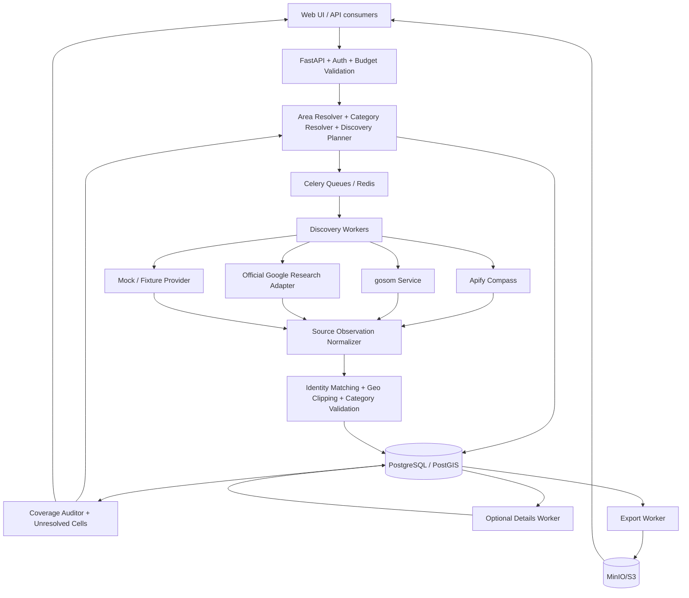

# GeoDiscovery: Product Requirements and Technical Architecture

**Status:** Development specification, version 1.0  
**Research checkpoint:** 2026-10-17  
**Intended reader:** Coding agent, technical founder, engineering team  
**Primary objective:** Find and export the highest possible number of distinct, correctly categorized businesses in an explicitly defined geographic area, while measuring uncertainty and controlling cost.

> This document is the product and architectural source of truth. Read `AGENTS.md` and `BUILD_PLAN.md` before implementation. Build phase by phase, rather than trying to implement all planned features in one coding-agent pass.

## 1. Product definition

GeoDiscovery is a geographic point-of-interest (POI) discovery, extraction, auditing, and export platform. It aims to reproduce useful Scrap.io capabilities while improving on the most difficult feature: recursive, high-coverage discovery of businesses in a city, borough, county, state, country, circle, polygon, or multipolygon.

A successful user flow is:

1. Choose a region (for example, the borough of Manhattan or a custom boundary) and one or more business categories.
2. Preview the **actual** territory geometry, category interpretation, supported source(s), field coverage, and estimated spend.
3. Choose basic, standard, or extended place-data depth and a monetary budget.
4. Launch a resumable, asynchronous discovery job.
5. Observe the geographic cells searched, where results overlap, where search results appear saturated, where errors occurred, and which cells remain unresolved.
6. Retrieve deduplicated place records that lie within the requested boundaries and match the requested categories, with source/observation timestamps.
7. Export authorized records as CSV, JSONL, XLSX (size-limited), or Parquet; schedule later rechecks.

**Central principle:** Neither a result count below a UI cap nor a completed job alone establishes completeness. The platform must report the strength and limits of its coverage evidence.

### Target users

- Technical users studying regional coverage and extracting business datasets.
- Agencies or researchers looking for narrowly defined business sets.
- Later: nontechnical SaaS customers, API integrators, and downstream enrichment systems.

### Design priorities (highest first)

1. Coverage and geographic correctness.
2. Reproducibility, observation provenance, and transparent gaps.
3. Data quality, category precision, and stable deduplication.
4. Cost predictability and reliable job execution.
5. Ease of use, broad provider choice, and extensibility.

### Explicitly out of scope for initial MVP

- Crawling business websites for emails or social links. Provide a clean enrichment plugin boundary, but do not implement website crawling in MVP.
- Bulk scraping or storing review text, photos, reviewer profiles, or personal-contact data by default.
- Promising 100% of Google Maps listings in a geographic region.
- Maintaining a global map-wide index before the first customer need is established.
- Automatic account creation, CAPTCHA solving, impersonation, or attempts to defeat provider abuse controls.
- Circumventing quotas with multiple Google Cloud projects.

## 2. Verified constraints that determine the design

| Question | Current documented behavior | Implication |
|---|---|---|
| Why does one Maps browser search not show everything? | The familiar roughly 120-item UI ceiling is a *single search/view* phenomenon and can vary by interface and search. | Multiple independent geographic searches are necessary for broad discovery. |
| Official Nearby Search (New)? | `maxResultCount` is 1 to 20 per request, with a circular `locationRestriction`. | Repeated centers/radii are required; zoom is not a Nearby Search API parameter. |
| Official Text Search (New)? | Up to 20 per page; pagination can provide up to 60 for one search. | Pagination is useful but not a substitute for partitioning. |
| Official Places Aggregate API? | `INSIGHT_COUNT` returns counts, `INSIGHT_PLACES` returns IDs if matching count <= 100. Both insights can be requested together. | For approved uses, an area can be recursively split until IDs are retrievable; not all tiny/dense cells can be resolved. |
| Aggregate API geometry constraints? | Area 1,556.86 to 2,000,000,000,000 sq m. Custom polygons must be closed, simple, counterclockwise and <= 7,000 vertices. | Geo planner must simplify/decompose shapes, use metric units, and record terminal unsplittable cells. |
| Aggregate type coverage? | Supports documented Table A place types, not arbitrary free-text business taxonomy. Defaults to operational status unless overridden. | Normalize category requests and keep unsupported terms in a separate search path. |
| Google API content retention? | Place IDs have a caching exemption; other Google Maps content is restricted. Aggregate POI count caching is limited by service-specific terms. | Never treat an official-API response as automatically suitable for a permanent resold lead database. |
| Apify Compass Maps Scraper? | Accepts `searchStringsArray`, `locationQuery`, `customGeolocation`, `maxCrawledPlacesPerSearch`, and optional detail/enrichment settings. Auto-partitions geographic searches. | Make this the first managed collection adapter; do not duplicate its tiling blindly. |
| gosom scraper? | MIT-licensed Go repo with CLI, REST API, PostgreSQL-backed operation and bounding-box grid mode. | Candidate self-hosted adapter; its fixed grid does not itself certify completeness. |

**Important:** Official count-guided discovery is implemented as an opt-in `RESEARCH_GOOGLE_AGGREGATE` adapter unless permitted production use, retention, and exports have been verified. Google places data is not merged into unrestricted commercial datasets by default. The official and third-party extraction paths require separate policy records.

Current reference documents: see `REFERENCES.md`.

## 3. Feature requirements

Priority key: **P0** first runnable MVP; **P1** production-ready MVP; **P2** post-MVP; **P3** future.

### Scrap.io parity checklist and extensions

Current Scrap.io (2026) advertises extraction from Google Maps, Apple Maps and Bing Maps; searches in 195 countries, 4,000+ business categories, city/county/state/country targeting, custom polygons/radii, multi-category filters, reverse phone/email/domain/URL lookup, file enrichment, MCP, REST API, ongoing database refresh, credit-governed exports and higher-tier team features. Do not mistake all of these for MVP blockers: build the durable data model and adapters now, implement in phases.

| Capability | Product phase | Notes |
|---|---|---|
| Google Maps discovery beyond 120 via recursive geography | P0/P1 | Primary engineering work. |
| City, state, county/borough, country, postal area and custom geometry | P0/P1 | Prefer exact boundaries over fuzzy free-text localities. |
| Primary/secondary category and multiple categories per search | P0/P1 | Ensure a category means the same across providers where possible. |
| Basic and detailed business place attributes | P0/P1 | Separate field packages and details stage. |
| Multi-map providers (Apple/Bing) | P2 | Source adapters and rights checks first. |
| Website, email, social and company technology enrichment | P2 | Separate pipeline, not blended into discovery. |
| Reverse lookup by domain, email, phone, map place ID | P2 | May need a separately licensed reverse index. |
| Upload CSV and return enriched CSV | P2 | Preserve original columns and user upload privacy. |
| Automatic change tracking and refreshing of targeted territories | P1 | Avoid falsely claiming every unseen record has closed. |
| Large-region SaaS search and export API | P1 | Async jobs, pagination, CSV/JSONL/XLSX/Parquet, tenant auth. |
| MCP and chat-based access | P2 | Thin interface to existing, permission-checked API. |
| Quotas and export credits | P1 | Support unique-lead-period accounting if selected as pricing model. |
| Usage analytics, team plans, SSO and enterprise SLA | P2/P3 | Only after reliable underlying collection is measured. |
| Cell-level evidence of coverage and unresolved areas | P0/P1 | Core differentiation beyond ordinary export tools. |
| Compare multiple providers by qualified-record yield | P1 | Cost and quality experiments are first-class product features. |
| Independent category and geographic verification | P0/P1 | Needed to make output substantially more useful than raw rows. |

**Competitive pricing behavior to study:** Scrap.io's published plans charge monthly export credits, with a place counted once in a 30-day period rather than every time it appears in a file. This may be attractive for customers but cannot be equated with the underlying provider's per-query bill. Make credit policy configurable in our billing subsystem and keep discovery charges separate from export credits.

### 3.1 Search and geographic input

| ID | Feature | Priority | Acceptance condition |
|---|---|---|---|
| GEO-01 | Country, state/province, county/district, borough/ward, city and postal code search | P0 | User can choose a resolved, uniquely identified region. |
| GEO-02 | Geographic hierarchy and administrative codes | P0 | `country_code`, hierarchy IDs, parent IDs, name, source and boundary version saved. |
| GEO-03 | Polygon/multipolygon GeoJSON input | P0 | Validated, displayed, persisted in WGS84; holes/islands handled correctly. |
| GEO-04 | Radius and bounding-box search | P0 | Correct units, coordinate order and boundary tests. |
| GEO-05 | Map UI for boundary preview | P1 | Selected shape is visible and editable; map data source complies with each provider's rules. |
| GEO-06 | Pasted Google Maps search URL | P1 | Parser extracts only verified, unambiguous center/zoom/query; uncertain boundaries demand user review. |
| GEO-07 | Multiple disconnected regions in one project | P1 | Job aggregates results without losing each region's provenance. |
| GEO-08 | Regions worldwide, including antimeridian and polar edge cases | P2 | Geometry tests cover crossing the 180th meridian and high latitudes. |
| GEO-09 | Saved territories, reusable polygons, region versions | P1 | Saved geometry can be selected again with exact version. |

### 3.2 Categories, queries, and exact matching

| ID | Feature | Priority | Acceptance condition |
|---|---|---|---|
| CAT-01 | Search terms and supported provider categories | P0 | Search request stores exact user term and resolved category IDs. |
| CAT-02 | Primary-only versus any-category option | P0 | Filtering distinguishes main from secondary category if source supports it. |
| CAT-03 | Include/exclude categories; related subtype expansion | P1 | User can preview expanded categories before spending. |
| CAT-04 | Locale/language and regional synonym dictionaries | P1 | Stable category mapping across languages; no silent fuzzy broadening. |
| CAT-05 | Review queue for ambiguous category matches | P1 | Nonmatching/uncertain records are labeled, not quietly counted as correct leads. |
| CAT-06 | All-POI mode | P2 | Requires explicit category plan, high-cost warning and bounded resource settings. |

### 3.3 Discovery engine

| ID | Feature | Priority | Acceptance condition |
|---|---|---|---|
| DIS-01 | Async jobs and per-cell task graph | P0 | Each job's plan and task completion states persisted. |
| DIS-02 | Initial tessellation of requested territory | P0 | Every part of original polygon is represented; no accidental gaps. |
| DIS-03 | Adaptive subdivision | P0 | Dense/saturated cells split within budget/depth/geometry constraints. |
| DIS-04 | Overlapping/offset searches as diagnostic probes | P1 | Configurable probes measure marginal new IDs; duplicates deduped. |
| DIS-05 | Provider interface, mock adapter, Apify adapter | P0 | Same job can run against deterministic fixture or managed adapter. |
| DIS-06 | gosom CLI/REST adapter | P1 | Invokes external collector with explicit input/output contract. |
| DIS-07 | Google official Aggregate + Details research adapter | P1 | Respects <=100 IDs, minimum-area and storage restrictions. |
| DIS-08 | Official Nearby/Text reference adapters | P2 | Field masks, pagination, spend and source restrictions honored. |
| DIS-09 | Resume/retry/cancel/partial completion | P0 | No lost work; repeated callback does not create duplicate charges/rows. |
| DIS-10 | Cross-source corroboration and optional fallback | P1 | Sources remain individually attributable and commercially usable only where permitted. |
| DIS-11 | Saturation and unresolved-area explanations | P0 | Unresolved cells visible in job report and export manifest. |
| DIS-12 | Provider-specific backoff, throttling and circuit breakers | P1 | Errors do not generate runaway retries or unlimited charges. |

### 3.4 Records, field packages and data quality

Core **basic package**: internal UUID, original provider identifier(s), name, listing/search URL, category/primary category, normalized business status, address, admin geography, lat/lon (when available), collected timestamp, provider, raw-field availability metadata.

**Standard package**: phone number(s), website URL, rating and review count, opening hours, price band, categories, contact completeness, and place identifiers, when available from selected source.

**Extended place details** (on demand, *not* website enrichment): additional Google Maps attributes where available and permitted, accessibility, services, booking/order links, menus, popular times, place containment, review/photo metadata, and supported other structured listing attributes. Reviews and image bodies are separately costed optional modules with explicit privacy rules. Never infer unavailable attributes from blanks.

| ID | Feature | Priority |
|---|---|---|
| DATA-01 | Typed canonical place record with provider-specific `extras` | P0 |
| DATA-02 | Place ID/CID/Google ID and other source identifiers where actually supplied | P0 |
| DATA-03 | Stable exact-source-ID deduplication | P0 |
| DATA-04 | Possible duplicate detection based on normalized name, phone, website and proximity | P1 |
| DATA-05 | Human-verifiable merge decisions; no automatic merges on weak fuzzy matches | P1 |
| DATA-06 | Strict point-in-territory validation, preserving rejected observations | P0 |
| DATA-07 | Place status including operational, temporarily closed, permanently closed and unknown | P0 |
| DATA-08 | Per-field source, capture time and confidence/availability | P1 |
| DATA-09 | Place-details lookups as a separate queue | P1 |
| DATA-10 | First-seen/last-seen and comparisons between completed runs | P1 |
| DATA-11 | Attribute change history (license/retention permitting) | P2 |
| DATA-12 | Reviews, photos and popular-times collection | P2, explicitly opt-in |
| DATA-13 | Website and contact enrichment as separate plugin system | P2; do not implement in MVP |

### 3.5 Product interface, search and exports

- **P0:** New-job form, saved jobs, task progress, count of unique matches, errors, basic results table, CSV/JSONL download, budget estimate and enforcement.
- **P1:** Interactive boundary editor, tile overlay with completeness status, category filtering, field-package picker, source and license indicators, full text/filter search, JSON/CSV/XLSX/Parquet exports, export history, saved templates, user-defined exclusions and blacklists, scheduled reruns, compare-runs report, API keys, webhooks and team roles.
- **P2:** Country-scale job sharding, scheduled alerts, low-coverage remediation suggestions, user-defined pipelines, MCP endpoint, multi-source reverse business lookup by domain/phone/place ID, S3 exports, CRM connectors and richer analytics.

Export filter examples: source, category, primary category, country/state/city, status, rating, website-present, phone-present, last-seen, first-seen, match-confidence, and source-specific additional fields. Export job must preserve exact criteria and output schema version.

### 3.6 SaaS and administration

P1: user/workspace/tenant, roles (owner, admin, member, read-only), API key scopes, quota ledger, hard per-job cost cap, subscription/credit balances, export credits, billing-event audit, provider configuration, run audit logs, abuse protections, and usage reports. No real payment-provider integration until end-to-end extraction economics are measured; stub a billing gateway initially.

## 4. Recommended implementation stack

Build as a **modular monolith with separate async workers**, not many microservices.

| Concern | Choice | Rationale |
|---|---|---|
| Backend/API | Python 3.12, FastAPI, Pydantic v2 | Strong GIS/data tooling, type-safe API, straightforward agent development. |
| Data model/migrations | SQLAlchemy 2, GeoAlchemy2, Alembic | Transactional modeling and PostGIS support. |
| Spatial data | PostgreSQL 16 with PostGIS | Exact polygon containment, GiST indexes, geometry ops. |
| Worker jobs | Celery + Redis | Good initial async task semantics and queue separation. |
| Geometry/planning | Shapely 2, PyProj; H3 optional for analytics | Correct geometry/projection and deterministic subdivision. |
| Managed scraping | Apify API, Compass `compass/crawler-google-places` | Strong geographic search; stable managed extraction adapter. |
| Self-hosted scraping | `gosom/google-maps-scraper` in an external container/service | Reuse MIT Go code; isolate scraper process failures. |
| Official data | Google Places Aggregate and Places (New) HTTP clients | Research-approved source, policy-bound. |
| Secondary reference POIs | Overture Maps places; optional OSM | Independent licensed reference, not a perfect Google ground truth. |
| Frontend | Next.js + TypeScript + Tailwind + shadcn/ui | Quick admin/product interface with maintainable components. |
| GIS display | MapLibre GL JS with OpenStreetMap/other permitted tiles | Polygon and independently licensed POI rendering. Google-derived map data requires source-specific display compliance. |
| Object storage | MinIO locally; S3-compatible service in production | Exports and permitted raw artifacts with lifecycle rules. |
| Auth | Start with single-workspace API-key auth for dev; move to OIDC/Auth.js + backend verification | Avoid building an identity platform before discovery works. |
| Telemetry | OpenTelemetry, Prometheus metrics, structured JSON logs, Sentry-compatible errors | Per-task performance/cost/quality visibility. |
| Testing | pytest, Hypothesis, pytest-postgresql, Playwright E2E | Deterministic fixtures plus spatial/property tests. |
| Packaging | Docker Compose locally; one API + separate Celery workers + DB/Redis/MinIO | Runs on Linux, Windows WSL2/Docker Desktop and cloud VMs. |

Pin and lock tested dependency versions at implementation time. Use `uv` for Python and `pnpm` for JS; enforce Ruff, mypy/pyright, ESLint, formatting and migrations in CI.

### Proposed repository tree

```text
geodiscovery/
  AGENTS.md
  docs/PROJECT_SPEC.md
  docs/BUILD_PLAN.md
  docs/QA_PLAN.md
  docs/REFERENCES.md
  api/openapi.yaml
  apps/web/                         # Next.js
  services/api/app/
    api/routes/                     # HTTP API; thin controllers
    core/config.py                  # secrets, policy, settings
    domain/                         # geometry, jobs, places, budgets
    models/                         # SQLAlchemy database tables
    schemas/                        # Pydantic transport contracts
    providers/
      base.py                       # capabilities + Provider interface
      mock.py
      apify_compass.py
      gosom.py
      google_aggregate.py          # opt-in research only
      overture.py
    discovery/
      area_resolver.py
      tessellator.py
      planner.py
      sampling.py
      coverage.py
      matcher.py
    workers/
      tasks.py
      ingestion.py
      detail_lookup.py
      export.py
    retention/
      policy.py
      purger.py
  migrations/
  tests/unit/
  tests/integration/
  tests/contracts/
  tests/property/
  tests/e2e/
  tests/fixtures/
  infra/docker-compose.yml
  infra/minio/
  .env.example
```

## 5. Logical architecture



Run phases are separate: **resolution -> planning -> discovery -> normalization -> quality checks -> optional details -> export**. This allows retrying a single stage without recollecting everything.

## 6. The discovery algorithms (the actual core IP)

### 6.1 Geometry and coverage primitives

- Internally persist GeoJSON and PostGIS geometry in EPSG:4326, coordinates always `[longitude, latitude]` as per GeoJSON.
- Perform **distance/area calculations in meters** using an appropriate projected coordinate reference system (or geography/geodesic methods); do not treat latitude/longitude degrees as meters. Do not use EPSG:3857 areas as authoritative at high latitudes.
- Convert single admin regions into versioned polygons; a request may comprise a `MultiPolygon`, including islands or exclaves. Preserve holes.
- Use a deterministic quadtree for recursive *rectangular* subdivision. At each node, intersect with the requested polygon to form effective search geometry. For providers that only support simple polygons, decompose into valid simple parts and track parent-child membership.
- Use controlled overlap or offset probes when necessary, and always dedupe across them. If the same point lies on two boundaries, assign a stable owner while preserving observations.
- Country-sized polygons should first be partitioned into administrative regions or manageable top-level geographic chunks before provider calls. Do not send requests exceeding provider maximum area or vertex limits.
- Never claim that a polygon is fully searched because its centroid was visited; coverage is a geometric property of cells actually searched.

### 6.2 Algorithm A: official count-guided recursive collector (RESEARCH ONLY by default)

**Use case:** evaluate the technical ability to identify all matching IDs within documented Aggregate API boundaries, with an explicitly approved source-policy mode.

Google accepts `INSIGHT_COUNT` and `INSIGHT_PLACES` in one request. If there are more than 100 places, place IDs are omitted, so divide the search polygon and repeat.

```text
function collect_with_aggregate(area, type_filter, budget, depth=0):
    validate_polygon_or_split_for_provider(area)
    if provider_area(area) > MAX_PROVIDER_AREA:
        for part in deterministic_partition(area):
            collect_with_aggregate(part, type_filter, budget, depth + 1)
        return
    if provider_area(area) < MIN_PROVIDER_AREA:
        mark_unresolved(area, "below_aggregate_min_area")
        return
    if budget.exhausted():
        mark_unresolved(area, "budget_exhausted")
        return

    response = aggregate.compute_insights(
        area=area,
        types=type_filter,
        insights=[INSIGHT_COUNT, INSIGHT_PLACES],
        operating_status=explicit_user_choice,
    )
    persist_policy_approved_audit(response)
    if response.count <= 100 and ids_are_returned:
        record_place_ids(response.place_ids, area, response.count)
        mark_leaf_complete_for_this_provider_query(area)
    else if depth < MAX_DEPTH and can_split_into_valid_provider_areas(area):
        for child in split_area_by_geometric_quadtree(area):
            collect_with_aggregate(child, type_filter, budget, depth + 1)
    else:
        mark_unresolved(area, "too_dense_or_unsplittable")
```

**Critical subtleties:**

1. Min area is **1,556.86 sq m**, max area **2 trillion sq m**, custom polygon vertices <= 7,000, counterclockwise, closed, non-self-intersecting. Very small clipped slivers may need to be covered by valid overlapping shapes or left unresolved.
2. Google counts polygons/intersecting entities differently for some large features (such as parks or airports). Counts of child polygons need **not** add up to the parent count due to boundary intersections, region approximation, source freshness and classification. Never assert mathematical additivity without evidence.
3. A result of 0 or <=100 is not an exhaustive guarantee across Google Maps UI search and other query terms. It is only completeness relative to **this Aggregate API filter and eligible data model**, assuming documented behavior.
4. Aggregate supports listed place types, not every colloquial category and keyword. Test category equivalence against UI/actor datasets.
5. Store official Place IDs under their permitted caching exception; retain and reuse other returned content only as the applicable terms permit. Google POI count retention and derivative use are restricted. A production commercial integration requires review; keep this adapter isolated by feature flag and use-purpose field.
6. Details retrieval is not free or guaranteed. Official Places Details requires field masks, with phone, website, ratings and hours typically triggering more expensive SKU tiers. Use a separate details queue and budget.
7. For research datasets spanning large countries, first partition geography by official limits and documented supported boundaries.

**Verification track:** For each test region, compare counts/IDs from direct Aggregate query, IDs union from children, the native Apify collector, gosom grid collector and manually identified missing examples. Label disagreements, do not silently force equality.

### 6.3 Algorithm B: adaptive viewport/grid discovery (Apify/gosom and future own engine)

**Use case:** production-oriented data extraction using an approved commercial provider or self-hosted scraper, with coverage estimated from repeated search evidence rather than official counts.

Start with provider-native whole-region search if supported (Apify Compass). That actor already performs region splitting. Post-audit the results. In areas of uncertainty, perform separate targeted searches or controlled subregion jobs. For gosom, which supports rectangular grids, use its grid option for an initial pass and layer the platform's adaptive planner around it.

**Input:** area polygon, locale, normalized categories, search variants, desired detail depth, cost ceiling, coverage aggressiveness.

**Working algorithm:**

```text
queue <- coarse_cells_intersecting(requested_polygon)
while queue not empty and budget permits:
    cell <- queue.pop_priority_by_estimated_density_and_uncertainty()
    observations <- provider.search(cell.geometry_or_viewport, query_variant)
    persist_provider_run_and_raw_output_if_allowed()
    normalized <- normalize(observations)
    geofenced <- point_in_polygon_filter(normalized, requested_polygon)
    unique <- exact_identifier_dedup(geofenced)

    coverage_signals <- {
       provider_result_cap_proximity,
       distinct_ids_for_cell,
       new_id_gain_from_offset_or_repeat_probe,
       boundary_density_or_edge_clustering,
       provider_error_or_timeout_rate,
       category_ambiguity,
       independent_reference_overlap,
       historically_unresolved_neighbors
    }

    if cell_high_risk(coverage_signals) and can_split(cell):
        queue.enqueue(split(cell))
    elif needs_offset_probe(cell) and probe_budget_available():
        queue.enqueue(deterministic_offset_probes(cell))
    else:
        mark_cell_as_observed_with_quality_assessment(cell)

for cell in unresolved_cells:
    attach_unresolved_reason_and_severity(cell)

run_quality_audit_and_export_manifest()
```

**Do not hardcode** `120` as a universal provider cap. `120` typically refers to a particular Maps UI search context; per-URL and per-actor behavior may differ. Each adapter declares empirical thresholds and emits telemetry.

**First-pass planning values for experiments, NOT guarantees:** start with roughly 0.5-1.0 km cells in dense urban areas, larger cells in sparse areas, and evaluate zoom 15-17 for browser-based collectors. Calibrate in actual target countries. A hardcoded zoom of 16 is not an accuracy proof, and zoom is not an official Nearby Search API parameter.

**When a tile returns 70 but actually has 150:** only a count oracle, independent data/reference sample, repeated-offset discovery, or changed query decomposition can reveal the missing records. An unsaturated response alone is insufficient; random independent probes of apparently complete cells are required.

**Stop conditions:** provider says no further results AND repeated independent probes produce low marginal new IDs AND the tile meets current sampling policy; otherwise record `UNCERTAIN`, `SATURATED`, `BLOCKED`, `BUDGET_CAPPED`, `MIN_GEOMETRY`, or `PROVIDER_ERROR`.

### 6.4 Query expansion, category semantics and business identity

- A broad term such as `restaurant` can omit related but separately categorized businesses. Support optional query variants, primary/secondary category combinations and locale synonyms.
- Every variant multiplies discovery cost and duplicate work; dedupe globally by source ID and preserve `matched_by` provenance per query.
- Category correctness must be evaluated **after** collection. Exact geometry filtering is also post-collection unless an official API enforces it.
- Use exact source identity as highest-confidence match. Same phone or website alone is insufficient to merge branches of a chain. A multi-location brand legitimately has many places.
- Handle renamed, relocated, permanently closed and duplicate Google listings by allowing source-ID aliases, transitions and confidence-reviewed merge decisions.
- For entities with multiple addresses or service-area businesses, separate point-in-polygon accuracy from service-area eligibility. Default to physical coordinate where available; flag unlocated entities.

### 6.5 Coverage measurement

Store **counts with precise denominators**:

- `raw_observations`: every provider-emitted row before exact-ID dedup.
- `unique_source_ids`: deduplicated for a single source.
- `unique_cross_source_entities`: conservative entity-resolution output.
- `in_territory_unique`: source-unique records with confirmed coordinate inside the original requested geometry.
- `category_verified_unique`: correctly matching places after classification.
- `fully_processed_cells / planned_cells`: operational task completion (not recall).
- `saturated_cells / unresolved_cells`: spatial risk evidence.
- `marginal_new_ids_per_probe`: additional discoveries produced by another viewpoint/search variant.
- `reference_overlap`: overlap with Overture/other independent data; neither dataset represents absolute truth.
- `audit_sample_recall` and `audit_sample_precision`: compared against a human-verified reference set, with sample definition.

Coverage report should use flags such as `COUNT_VERIFIED_FOR_EXACT_FILTER`, `HIGH_EVIDENCE`, `PARTIAL`, `UNRESOLVED`, `NOT_EVALUATED`. Never display an unsupported percentage such as `99.8% of Google businesses found`.

A useful exploratory estimator is capture-recapture from independent samples; implement as research-only and disclose that search results are ranked and samples are not statistically independent, so the estimate may be badly biased.

## 7. Provider adapters and contract

Define one provider abstraction without forcing capabilities that not every source has:

```python
class ProviderCapabilities(BaseModel):
    supports_polygon: bool
    supports_multipolygon: bool
    supports_circle: bool
    supports_bbox: bool
    supports_native_grid: bool
    supports_count: bool
    supports_exact_place_ids: bool
    supports_details: bool
    supports_primary_category: bool
    supports_resume: bool
    max_area_m2: float | None
    min_area_m2: float | None
    max_vertices: int | None
    max_results_per_query: int | None
    cost_model: str
    retention_policy_id: str

class PlaceObservation(BaseModel):
    provider: str
    source_id: str
    observed_at: datetime
    search_task_id: UUID
    name: str | None
    latitude: float | None
    longitude: float | None
    categories: list[str]
    raw: dict  # retained only where policy permits
    field_availability: dict[str, bool]

class DiscoveryProvider(Protocol):
    async def start_search(self, task: SearchTask) -> ProviderRun: ...
    async def poll(self, run_id: str) -> ProviderRunStatus: ...
    async def iter_observations(self, run_id: str) -> AsyncIterator[PlaceObservation]: ...
    async def cancel(self, run_id: str) -> None: ...
```

Keep count, details and geography-resolution as **separate interfaces** instead of methods all providers must fake. Adapters must translate provider-specific input formats and explicitly reject unsupported requested features.

### Apify Compass adapter

Actor: `compass/crawler-google-places` (`https://apify.com/compass/crawler-google-places`). Supported inputs include `searchStringsArray`, `locationQuery`, `customGeolocation`, `maxCrawledPlacesPerSearch`, `language`, `scrapePlaceDetailPage`, `skipClosedPlaces`, and optional filters.

- **Never use obsolete `maxCrawledPlaces`**. Actual accepted input is `maxCrawledPlacesPerSearch`, which applies per search term or URL. An Apify issue documents surprise charges from the obsolete field being ignored.
- If the provider already performs recursive region splitting, run its native search first. Do not automatically tile everything a second time; use the platform planner for verification and targeted gap closure.
- A user-submitted complete search phrase containing the location can trigger UI-style result limiting. Prefer separate search term and region fields when the actor provides them.
- Actor's `customGeolocation` is GeoJSON-like and uses **longitude, latitude** order. Provider validation must preserve this.
- Disable contact/social/leads/review/image add-ons for MVP unless specifically purchased. `scrapePlaceDetailPage` is a separately costed capability.
- Pass Apify actor-run `max_items` and `max_total_charge_usd` where supported, plus internal preflight and per-customer hard caps. Treat charged items, returned rows and unique exported places as three separate metrics.
- Prefer webhooks with idempotent event processing; polling is a fallback. Stream datasets in pages instead of loading millions of rows into memory.
- Store actor name, build/version, input hash, run ID, dataset ID, event charges, completion and errors.

### gosom adapter

Repo: `https://github.com/gosom/google-maps-scraper` (MIT license).

- Prefer separate Go container with CLI/API rather than copying unstable internals into Python.
- It supports `-grid-bbox minLat,minLon,maxLat,maxLon`, `-grid-cell` in km and `-zoom`, but its README notes results aren't strictly clipped to that bbox.
- Its `-fast-mode` is deliberately shallow (up to roughly 21 results per query) and incompatible with the `-grid-bbox` mode. **Do not use fast mode for high-coverage recursive discovery.**
- Use a provider-side run tracker, proper resource limits and output streaming into normalization. Treat its grid as a coverage acquisition method, not a completeness verifier.
- It already has standalone REST API/SaaS functions. Reuse rather than reimplement its crawler internals.

### Official Google adapters (research mode)

- Aggregate: `https://areainsights.googleapis.com/v1:computeInsights`, with simultaneous `INSIGHT_COUNT` and `INSIGHT_PLACES` when appropriate.
- Nearby Search (New): max 20 results and circular geography; not a 60-result nearby API.
- Text Search (New): up to 20 per page, up to 60 across pages for a search.
- Details (New): per-ID field masks and SKU-aware costing; do not request `*` in production.
- Distinguish temporary official query responses from indefinitely storable Place IDs.
- Source terms may forbid export/retention or combining Google result data with a non-Google map; policy adapter must enforce those constraints.

### Open/reference datasets

- Overture Places: the September 2026 theme contains roughly 80+ million global place features under documented source licenses. It is useful for independently seeded discoveries and discrepancy analysis, but explicitly warns about duplicate/junk records and incomplete properties.
- OSM: optional boundary/POI corroboration under appropriate attribution and ODbL obligations.
- Do not call independent-source differences proof that Google listings were omitted or vice versa; use them to identify candidates for manual verification.

## 8. Data design (minimum normalized schema)

Use UUID primary keys, timestamps in UTC, database migrations, tenant scoping, appropriate indexes, and immutable provider observations where storage policy permits.

| Table | Core columns / purpose |
|---|---|
| `tenants`, `users`, `memberships` | Access control and workspace context. |
| `api_keys` | Scoped hashed keys, revocation and usage auditing. |
| `geo_areas` | `id`, hierarchy, country/admin codes, names, source, version, PostGIS geometry, area and centroid. |
| `categories`, `category_aliases` | Canonical taxonomy, translations and provider mappings. |
| `discovery_jobs` | Tenant, geography, category filters, source config, status, cost caps, quality settings, created/completed timestamps. |
| `search_cells` | Job, parent, quadtree path, depth, polygon, source, provider constraints, state, quality signals, terminal reason. |
| `search_tasks` | Cell + provider + query variant + input hash, attempts, state, estimated cost, scheduling priority. |
| `provider_runs` | External IDs, actor build, dataset IDs, timings, transport status, usage/billing telemetry. |
| `places` | Canonical internal entity identity; only fields backed by authorized sources. |
| `place_source_ids` | `(provider, source_id)` unique index; aliases, ID validity dates. |
| `place_observations` | Provider-specific evidence, observed time, job/task, raw blob pointer if allowed, validity/retention. |
| `place_categories` | Category, primary/secondary, source, observation. |
| `job_place_matches` | Job, place, original search term, in-region flag, category match decision, inclusion reason. |
| `merge_candidates`, `merge_decisions` | Fuzzy matching workflow and reversible human decisions. |
| `quality_audits` | Job totals, unresolved reasons, precision/recall sample references, coverage report version. |
| `source_policies` | Retention, display, export, derivative-use and source-license constraints. |
| `exports` | Job, filters, fields, object key, format, policy checks, row count, manifest, download expiry. |
| `usage_events`, `budget_reservations` | Provider charges, customer credits, hard caps and refunds. |
| `blacklists` | Place IDs, website domains, normalized phones, optional emails, tenant scope. |
| `scheduled_jobs`, `webhook_endpoints` | Recheck and callback configuration. |

**Indexes:** GiST on geographic geometries; composite `(tenant_id, job_id, state)` on tasks; unique `(provider, source_id)` for source identities; unique `(job_id, place_id)` for job matches; `(tenant_id, status, created_at)` on jobs; partial indexes for unresolved cells and live tasks. Use `SELECT FOR UPDATE SKIP LOCKED` or queue-level equivalents for worker claiming, not unguarded optimistic execution.

**Raw response retention:** Each observation has `source_policy_id`, `raw_retention_until`, and `export_allowed`. Official Google source records may retain only Place ID plus permitted metadata, with ephemeral field payloads expiring by policy. Do not create a permanent blended `raw_json` table for every provider.

## 9. Workflow and state machines

### Job states

`DRAFT -> ESTIMATED -> QUEUED -> PLANNING -> DISCOVERING -> AUDITING -> [DETAILS] -> EXPORT_READY -> COMPLETED`

Other terminal/interrupt states: `PAUSED`, `CANCEL_REQUESTED`, `CANCELLED`, `PARTIAL`, `FAILED`, `BUDGET_EXHAUSTED`.

### Cell states

`PENDING -> RUNNING -> OBSERVED -> SPLIT` or `CLOSED_HIGH_EVIDENCE` or `UNRESOLVED`.

### Reliability rules

- Every API create call accepts `Idempotency-Key`.
- Every provider execution stores a request fingerprint; repeated webhook events or retries never duplicate job matches or bill user credits twice.
- Worker leases, heartbeats and timeouts allow safe recovery after crash.
- A `RUNNING` job has a progress timestamp, not an ungrounded time-to-completion promise.
- Failed leaf tasks retry with capped exponential backoff for transient faults; invalid geometry or authentication failures fail fast.
- A partially completed job remains exportable **only with prominent partial/coverage warnings**.
- Budget is reserved before submission, reconciled after provider billing events, and never exceeded by a new task allocation. In-flight vendor charges may impose unavoidable overshoot; vendor-native hard run caps should be used where possible.

## 10. API surface

See `openapi.yaml` for a machine-readable starting contract. Base path: `/api/v1`. JSON by default.

- `GET /healthz`, `GET /readyz`
- `GET /geo/search?q=...&country_code=...&type=...`
- `POST /geo/resolve` (location choice -> GeoJSON boundary and confidence/source)
- `POST /geo/validate` (polygon/circle/bbox validation and preflight warnings)
- `GET /categories?query=...&locale=...`
- `POST /jobs/estimate` (provider calls, expected spend range, limits)
- `POST /jobs`, `GET /jobs`, `GET /jobs/{job_id}`, `POST /jobs/{job_id}/pause|resume|cancel`
- `GET /jobs/{job_id}/cells?bbox=...` (tile status map)
- `GET /jobs/{job_id}/quality` (coverage and uncertainty manifest)
- `GET /jobs/{job_id}/places` (cursor pagination and filters)
- `POST /jobs/{job_id}/details` (opt-in details queue)
- `POST /exports`, `GET /exports/{export_id}`, `GET /exports/{export_id}/download`
- `GET/POST /blacklists`, `DELETE /blacklists/{id}`
- `GET /providers/capabilities`, `GET /billing/usage`, `GET /billing/rates`
- `GET/POST /schedules`, `GET/POST /webhooks`
- `POST /reverse-lookup` (P2, supported identifiers only)

**Streaming:** Polling API is required for MVP; server-sent events may be added for the web dashboard. User-facing API response should never include provider tokens or opaque errors containing secrets.

### Example job request

```json
{
  "name": "Dental clinics in Manhattan",
  "area": {
    "kind": "geo_area_id",
    "geo_area_id": "YOUR_VERSIONED_AREA_UUID"
  },
  "search": {
    "keywords": ["dentist"],
    "categories": ["dentist"],
    "category_match": "primary_or_secondary",
    "locale": "en-US",
    "status_filter": ["operational", "temporarily_closed"]
  },
  "collection": {
    "provider": "apify_compass",
    "strategy": "adaptive_audited",
    "field_package": "standard",
    "max_search_depth": 12,
    "allow_probe_searches": true
  },
  "budget": {
    "currency": "USD",
    "max_spend": 30.0,
    "max_provider_tasks": 1000
  },
  "output": {
    "export_format": "csv",
    "include_coverage_manifest": true
  }
}
```

### Example job quality response

```json
{
  "job_id": "JOB_UUID",
  "coverage_status": "PARTIAL",
  "metrics": {
    "raw_observations": 4952,
    "unique_source_ids": 4238,
    "in_territory_unique": 3970,
    "category_verified_unique": 3714,
    "cells_planned": 246,
    "cells_completed": 240,
    "cells_unresolved": 6,
    "probe_new_id_gain_ratio": 0.018
  },
  "unresolved_reasons": [
    { "code": "BUDGET_EXHAUSTED", "cells": 4 },
    { "code": "PROVIDER_ERROR", "cells": 2 }
  ],
  "claim": "3714 verified matches discovered; total available places unknown"
}
```

Numbers are illustrative test fixtures, not a claimed real extraction.

## 11. Cost model and commercial readiness

**Never charge or estimate exclusively from advertised price-per-result**. Actual costs depend on all queries, add-ons, duplicates, discarded out-of-territory rows, tasks that fail, refresh passes and details retrieval.

Current publicly documented reference prices (October 2026; verify before using in customer billing):

| Provider SKU | Reference rate | Caveat |
|---|---:|---|
| Apify Compass scraped place | $4/1,000 Free, $3 Starter, $2 Scale, $1.50 Business | Additional feature/event charges may apply; vendor subscription matters. |
| Apify Compass additional place details | $2/1,000 Free/Starter, lower on upper plans | Separate event; not included by default. |
| Google Aggregate API | $10/1,000 beyond monthly free allowance | Per successful billed request; subject to current SKU rules, licensing. |
| Google Nearby Search (New) Pro | $32/1,000 beyond free allowance | Field-mask-dependent SKU. |
| Google Text Search (New) Pro | $32/1,000 beyond free allowance | Field-mask-dependent SKU and pages. |
| Google Place Details (New) Enterprise | $20/1,000 beyond free allowance | Website, phone, ratings and hours can trigger Enterprise. |
| gosom | No software licensing fee (MIT) | Pay compute/proxy/operational costs and engineering maintenance. |

Revenue pricing ($49/month for 10k leads, higher tiers, etc.) must be decided **after** measured cost per unique *valid* in-territory lead, not cost per raw response row.

For a job compute and persist:

```text
provider_cost = sum(actual_provider_billing_events)
internal_cost = worker_runtime + egress + storage + queue + reprocessing
cost_per_raw_row = total_cost / raw_observations
cost_per_unique = total_cost / unique_source_ids
cost_per_qualified = total_cost / category_verified_in_territory_unique
provider_yield = category_verified_in_territory_unique / max(1, billed_rows)
```

Estimate should present a range, explicit assumptions and a hard cap. Reconcile against vendor invoices or billing APIs before a real customer invoice is issued.

## 12. Security, data rights, and deployment

- Use per-tenant role-based access controls and query-level tenant enforcement.
- Keep Google, Apify and other API keys in server-side secrets storage, never client code or URLs.
- Use HTTPS, request size bounds, upload validation and archive decompression limits for GeoJSON and CSV.
- All downloaded files use tenant-scoped short-lived signed URLs.
- Prevent SSRF in future website enrichment / user URL fetchers, and rate-limit all public endpoints.
- Make every third-party source opt-in with a declared license/use case; block prohibited persistence/export combinations at the API boundary.
- Support a display policy: independent/Overture POIs may use permitted non-Google mapping, while official Google content follows Google map/attribution restrictions.
- Restrict automated third-party scraping to approved adapters and their supported rate policies. Treat CAPTCHA/block responses as failure or human review events, not invitations to automate bypass.
- Avoid storing review author identities or personal emails unless a separate approved feature explicitly requires them.
- Track source field retention and purge expired content (official API place IDs are separately allowed).
- Logs must redact credentials and personal data.

MVP local startup: `docker compose up --build`; run migrations, seed reference boundaries/categories, start API + worker + Next.js. Include health checks and readiness gates. Production deployment: containers on cloud VM(s), managed Postgres with PostGIS, Redis, object store and a worker pool; deploy Kubernetes only after measured throughput warrants it.

## 13. Performance, scalability and operational requirements

These are internal acceptance targets, to be calibrated; not claims about third-party throughput.

- A saved geometry <= 10 MB should validate in < 5 seconds locally for common valid polygons (exclude unusually complex geometries; reject or queue simplification).
- Creating and estimating a job should not block while scraping; return quickly with a persistent ID.
- All result and export operations must use streaming pagination; no loading 100k rows into application memory.
- 100k raw observation fixtures ingest with stable memory usage and no duplicate `(provider, source_id)` keys.
- 10k deduplicated matching leads export in CSV within an acceptable load-test budget set during baseline measurement.
- Workers must resume after being killed during any of planning, crawl, normalize or export.
- Per-job budget enforcement must survive concurrent workers and duplicate callbacks.
- Geo search must perform well with GiST indexes; benchmark with realistic spatial distributions.
- Keep crawl latency, query efficiency, `429`/error rates, probe yield, unresolved cell area, provider bill and spend-per-qualified record on dashboards.

## 14. MVP release gates

The MVP cannot be declared working merely because a scrape returns 10,000 rows.

1. **Geometry validity:** 100% of fixture boundaries correctly resolved/validated; matching points are inside the requested polygon (or explicitly marked unresolved).
2. **Recursive plan correctness:** Complete coverage of a synthetic parent polygon by child cells, with intentional overlap handled and holes preserved.
3. **Deterministic high-density coverage test:** A mock provider that caps one query at 120 and hides arbitrary subset of records still triggers splitting/probes and discovers the expected fixture IDs under a defined budget.
4. **Real provider adapter tests:** 3 areas x 3 categories x 2 providers; record quality, cost, unique yield and failure rates. Requires separately enabled credentials.
5. **No false completeness:** Simulated hidden POIs, rate limits and minimum-area terminals must produce unresolved/uncertain flags, never a fabricated '100%'.
6. **Identity correctness:** Same place ID dedupes exactly; two locations of a chain remain separate; ambiguous fuzzy duplicates are reviewable.
7. **Crash safety:** Safe resume, task idempotency, queue recovery and cancellation verified.
8. **Cost safety:** No worker launches a task without budget reservation; Apify native run cap configured; unknown parameters rejected by the adapter.
9. **Export:** Correct inclusion/exclusion filters, authorized columns and per-source retention/export validation.
10. **Deployment:** Fresh checkout -> documented Docker Compose startup -> migrations -> mock job -> quality report -> export -> tests pass.

## 15. Decisions deliberately postponed

- Building a custom Google Maps HTTP/network-protocol scraper. Existing vendors and gosom are the first implementations to benchmark; the planner must remain independent.
- A global long-lived scraped Google-derived place index. Requires separate provenance, license and economic validation.
- Enterprise billing and complex CRM integrations.
- Deep AI qualification and chat workflows. These come after reproducible discovery is proven.
- Advanced capture-recapture coverage percentages without well-characterized sampling assumptions.

## 16. What the coding agent should build first

Build **one vertical slice** that takes a GeoJSON polygon and a category, runs the **mock adapter**, recursively subdivides when capped, stores provider observations, applies the polygon and category filters, and produces a quality report + CSV. Only then add Apify. The very first acceptance test should demonstrate that the algorithm can discover all records from a deterministic synthetic dataset whose parent search returns only 120 of 500 places.

See `BUILD_PLAN.md` for sequenced engineering tasks, `ALGORITHMS.md` for detailed implementation logic, `DATA_DICTIONARY.md` for field definitions, and `QA_PLAN.md` for fixtures, assertions and benchmark methodology.
